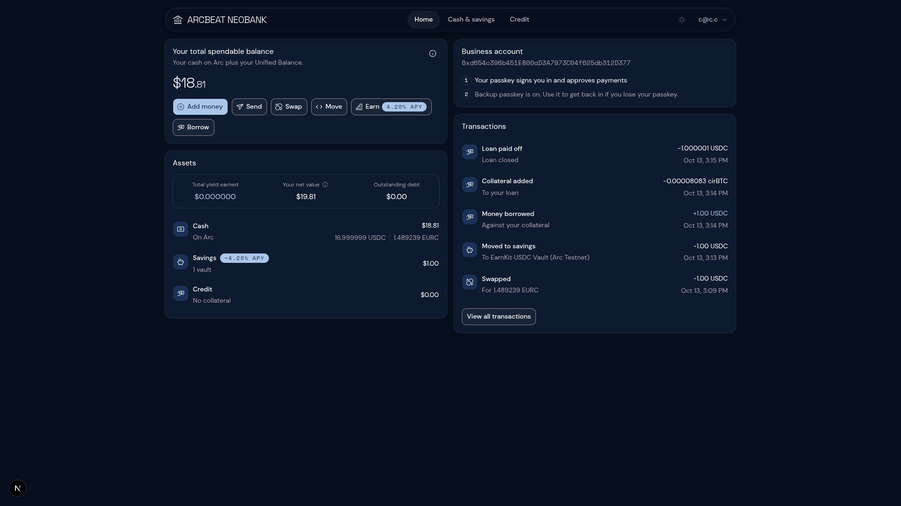

# Arcbeat Neobank

Manage a business treasury on Arc Testnet with a passkey. This [Next.js](https://nextjs.org/docs) sample uses [Supabase](https://supabase.com/docs), [ZeroDev smart accounts](https://docs.zerodev.app/), and [App Kits](https://docs.arc.io/app-kit) to demonstrate payments, swaps, bridging, earning, and borrowing. It also demonstrates fiat-to-USDC onramping with [Onramp Kit](https://docs.arc.io/app-kit/onramp) in sandbox. ZeroDev sponsors gas, and users sign transactions without a browser wallet.



## Table of Contents

- [Features](#features)
- [Prerequisites](#prerequisites)
- [Getting Started](#getting-started)
- [How It Works](#how-it-works)
- [Environment Variables](#environment-variables)
- [ZeroDev Setup](#zerodev-setup)
- [User Accounts](#user-accounts)
- [Available Scripts](#available-scripts)
- [Testing](#testing)
- [Deploy to Vercel](#deploy-to-vercel)
- [Security & Usage Model](#security--usage-model)
- [Legal](#legal)

## Features

- **Business account** — Sign up with email and a passkey, name the business, and add a backup passkey.
- **Fiat-to-USDC onramping** — Buy test USDC with fiat through the embedded [Onramp Kit](https://docs.arc.io/app-kit/onramp) widget in sandbox.
- **Payments** — Send USDC or EURC to saved contacts or wallet addresses.
- **Swap and move** — Exchange USDC and EURC, bridge USDC between Arc and Base Sepolia, or send it to Solana Devnet.
- **Unified Balance** — View USDC across chains and move it to cash on Arc.
- **Earn and borrow** — Deposit into vaults, withdraw, borrow USDC against collateral, and manage repayments.
- **Team controls** — Invite Operators with payment limits, approved currencies, and an expiry date.
- **Activity and diagnostics** — View transaction receipts and check service status in Settings > Developer.

## Prerequisites

- **Node.js v22+** — Install via [nvm](https://github.com/nvm-sh/nvm) (`nvm use` will read the `.nvmrc` file)
- **Docker Desktop** — required to run Supabase locally. [Install Docker Desktop](https://www.docker.com/products/docker-desktop/)
- **A passkey-capable browser and device** — used to create and approve transactions with the business account
- **A [ZeroDev project](https://dashboard.zerodev.app/)** — with Arc Testnet, Base Sepolia, and gas sponsorship configured (see [ZeroDev Setup](#zerodev-setup))
- **A Circle sandbox [API key](https://console.circle.com/)** — used for the onramp

## Getting Started

1. Clone the repository and install dependencies:

   ```bash
   git clone git@github.com:circlefin/arc-neobank.git
   cd arc-neobank
   npm install
   ```

2. Start the local Supabase instance (requires Docker Desktop running):

   ```bash
   npm run db:start
   ```

   On first start, Supabase creates the local database and applies the migrations in `supabase/migrations`. The output shows the Supabase URL and API keys needed in the next step. Run `npm run db:status` to see them again.

3. Set up environment variables:

   ```bash
   cp .env.example .env.local
   ```

   Fill in the three Supabase values from the previous step. Add `ZERODEV_PROJECT_ID` and a Circle sandbox `CIRCLE_API_KEY`, then complete [ZeroDev Setup](#zerodev-setup). Leave `ARC_E2E_*` blank unless running the testnet script.

4. Start the development server:

   ```bash
   npm run dev
   ```

   Open `http://localhost:3000`. Check `/api/health` for service status, then sign up with your email and a passkey. Local sign-in codes appear in [Mailpit](http://127.0.0.1:54324).

5. Fund the account for testing:

   Copy the business account's address and request Arc Testnet USDC from the [Circle faucet](https://faucet.circle.com). Borrowing also requires the market's collateral token.

## How It Works

- [Supabase](https://supabase.com/) handles email sign-in and stores business details, contacts, team records, and memos.
- [ZeroDev](https://docs.zerodev.app/) Kernel smart accounts use passkeys to approve transactions. Its paymaster sponsors gas on Arc Testnet and Base Sepolia.
- Circle App Kit and its Viem adapter handle Onramp, Send, Swap, Bridge, Unified Balance, Earn, and Borrow.
- ZeroDev permissions enforce Operator payment limits, currencies, and expiry onchain.
- Server routes proxy requests that require secrets. Balances and positions are read onchain; transaction history comes from the Arc Testnet explorer API.

**Recovery limitation:** Backup-passkey recovery works on Arc only. After recovery, adding or moving money from another chain is unavailable, and existing Unified Balance funds cannot be moved to cash. Moving to cash also requires a browser and passkey that support the WebAuthn PRF extension.

## Environment Variables

Copy [.env.example](.env.example) to `.env.local`. The three Supabase values, ZeroDev project ID, and Circle sandbox key are required. `ARC_E2E_*` values are only for the testnet script:

```bash
# Supabase
NEXT_PUBLIC_SUPABASE_URL=
NEXT_PUBLIC_SUPABASE_PUBLISHABLE_KEY=
SUPABASE_SECRET_KEY=

# ZeroDev
ZERODEV_PROJECT_ID=

# Circle, for the onramp. Use a sandbox (TEST_API_KEY) key.
CIRCLE_API_KEY=

# Arc Testnet check
ARC_E2E_OWNER_KEY=
ARC_E2E_SOLANA_RECIPIENT=
```

| Variable | Scope | Purpose |
| --- | --- | --- |
| `NEXT_PUBLIC_SUPABASE_URL` | Public | Local Supabase API URL (from `npm run db:status`). |
| `NEXT_PUBLIC_SUPABASE_PUBLISHABLE_KEY` | Public | Local Supabase publishable key (from `npm run db:status`). |
| `SUPABASE_SECRET_KEY` | Server-side | Local Supabase secret key for privileged writes (from `npm run db:status`). |
| `ZERODEV_PROJECT_ID` | Server-side | ZeroDev project ID from the [ZeroDev dashboard](https://dashboard.zerodev.app/). Used for the passkey server, bundler, and paymaster. See [ZeroDev Setup](#zerodev-setup). |
| `CIRCLE_API_KEY` | Server-side | Circle sandbox API key (`TEST_API_KEY:…`) from the [Circle Developer Console](https://console.circle.com/). Used to start onramp sessions. |
| `ARC_E2E_OWNER_KEY` | Script only | Optional. A throwaway private key that owns the test account for `npm run test:arc`. The first run prints one to add. Use a key without real funds. |
| `ARC_E2E_SOLANA_RECIPIENT` | Script only | Solana Devnet recipient for the live test script. Required for its Solana transfer step. |

## ZeroDev Setup

One ZeroDev project provides the passkey server, bundler, and paymaster through the app's server routes.

1. Create a project in the [ZeroDev dashboard](https://dashboard.zerodev.app/).
2. Enable Arc Testnet and Base Sepolia.
3. Add a gas policy that sponsors transactions on both networks.
4. Save the project ID as `ZERODEV_PROJECT_ID` in `.env.local` (and Vercel if deploying).
5. Start the app and open `/api/health`. Both bundlers should support EntryPoint 0.7.

## User Accounts

- **Owner** — Sign up with email and a passkey. The Owner manages the business and can add a backup passkey for recovery. Local sign-in codes appear in [Mailpit](http://127.0.0.1:54324).
- **Operator** — The Owner invites Operators under Settings > Team and approves their limits with a passkey. Operators sign in with the invited email and can send payments within those limits. The Owner can revoke access.

## Available Scripts

- `npm run dev` — Start the Next.js development server
- `npm run build` — Create a production build
- `npm run start` — Start the production server
- `npm run lint` — Run ESLint
- `npm run typecheck` — Generate Next.js's route types, then check types with TypeScript
- `npm test` — Run the unit tests
- `npm run test:arc` — Run live Arc Testnet checks (see [Testing](#testing))
- `npm run db:start` — Start local Supabase (applies migrations on first start)
- `npm run db:stop` — Stop the local Supabase instance
- `npm run db:status` — Show local Supabase URLs and API keys
- `npm run db:reset` — Delete local database data and re-run all migrations
- `npm run db:migration <name>` — Create a new migration file in `supabase/migrations`
- `npm run supabase -- <command>` — Run any other Supabase CLI command

## Testing

`npm test` runs unit tests without credentials, Supabase, or network access. Use `npm run lint`, `npm run typecheck`, and `npm run build` for the remaining local checks.

`npm run test:arc` runs live Send, Swap, Earn, Borrow, Unified Balance, and bridge checks using a test account owned by a throwaway key. On the first run, it prints a key to add as `ARC_E2E_OWNER_KEY` in `.env.local`. Fund the account address it prints from the [Circle faucet](https://faucet.circle.com).

A full run spends or holds up to 2.51 test USDC. Borrow also needs cirBTC collateral; the script reports the required amount. Set `ARC_E2E_SOLANA_RECIPIENT` to a Solana Devnet address for the step that sends 0.50 test USDC there. These checks use a private key and do not test the browser passkey flow.

## Deploy to Vercel

1. **Supabase.** Create a project at [supabase.com](https://supabase.com/dashboard), then apply the migrations:

   ```bash
   npx supabase link --project-ref <your-project-ref>
   npx supabase db push
   ```

   Under Authentication:
   - Set the Site URL to your production URL.
   - Under Email Templates > Magic Link, use the subject `Your sign-in code` and the body of `supabase/templates/magic_link.html`, so the email carries the code the sign-in form asks for.
   - Keep the email code at 6 digits.
   - Add your own SMTP server. Supabase's built-in sender is for testing and sends only a few emails an hour.

2. **Vercel.** Import the repository at [vercel.com/new](https://vercel.com/new). Add the five variables from [Environment Variables](#environment-variables), using the hosted project's URL and keys from Supabase's API settings. The `ARC_E2E_*` variables are for the test script only and don't belong here.

3. **One domain.** A passkey belongs to the domain it was created on. Use your production domain (a custom domain or the project's `*.vercel.app` one). Each preview deployment has its own URL, so passkeys made on one don't work on another, or on `localhost`.

4. **ZeroDev.** Follow [ZeroDev Setup](#zerodev-setup).

5. **Check it.** Open `/api/health` on your domain. It answers `200` with `"status": "ok"` when every service is up, and `503` naming the ones that aren't. Point an uptime monitor at it. Settings > Developer shows what each check found.

GitHub Actions runs lint, type checks, unit tests, and a build on pull requests and pushes to `main`.

## Security & Usage Model

This sample application:

- Assumes testnet usage only
- Handles secrets via environment variables
- Is not intended for production use without modification

See [SECURITY.md](SECURITY.md) for vulnerability reporting guidelines. Please report issues privately via Circle's bug bounty program.

## Legal

Sample apps provided for demonstration and educational purposes only, intended for Arc testnet use only, and not production-ready. See [Arc.io](https://arc.io) for more.
